# DOKUMEN SPESIFIKASI KEBUTUHAN PRODUK & ARSITEKTUR SISTEM
## ASISTEN PATROLI SIBER & INTELIJEN MEDIA SOSIAL (TILIK)
### Hybrid 5-Platform Acquisition + NIST FIPS 198-1 HMAC-SHA256 Integrity + RapidOCR + BGE-M3 Cross-Lingual Self-Learning + Unified Operational Cockpit

---

**Identifikasi Dokumen:** `SYS-PRD-ARCH-2026-FINAL`  
**Status:** DRAF RESMI FINAL — TUGAS AKHIR D4 REKAYASA PERANGKAT LUNAK KRIPTOGRAFI (RPLK)  
**Versi:** 5.3 (*Tactical BLUF Dossier, 95.83% Adaptive Accuracy, Anti-Aliased Logo Omnipresence, & High-Craft Tactical Cockpit*)  
**Tanggal Rilis:** 18 November 2026  
**Lokus Penugasan:** Analisis Intelijen Siber Ruang Digital — Penanganan Isu Strategis Nasional IPOLEKSOSBUDHANKAM  
**Prinsip Desain:** *100% Local-First / On-Premise*, *Forensic Integrity (NIST FIPS 198-1)*, *100% Indonesian Output*, *Multi-User LAN Concurrency*, *Selective Compute*, *Anti-Noise Content/Metadata Disambiguation*, *Human-in-the-Loop Supremacy*, *Unified Single-Stream Cockpit*, *Anti-Slop & High-Craft Intelligence UI/UX*, *100% Dark/Light Theme Parity*, *Tactical BLUF Dossier Standard*, *Anti-Aliased Logo Omnipresence*, dan *Zero Dead-End Interconnectivity*.

---

## DAFTAR ISI

- [DAFTAR ISI](#daftar-isi)
- [BAB I: PRODUCT REQUIREMENT DOCUMENT (PRD)](#bab-i-product-requirement-document)
  - [1.1 Ringkasan Eksekutif & Latar Belakang](#11-ringkasan-eksekutif--latar-belakang)
  - [1.2 Batasan Arsitektur Utama (Core Architectural Constraints)](#12-batasan-arsitektur-utama-core-architectural-constraints)
  - [1.3 Profil Pengguna & Matriks Hak Akses (RBAC)](#13-profil-pengguna--matriks-hak-akses-rbac)
  - [1.4 Ruang Lingkup Sistem & Batasan Batas (Scope & Boundary)](#14-ruang-lingkup-sistem--batasan-batas-scope--boundary)
  - [1.5 Kebutuhan Fungsional (FR-01 s.d. FR-26)](#15-kebutuhan-fungsional-fr-01-sd-fr-26)
  - [1.6 Kebutuhan Non-Fungsional (NFR-01 s.d. NFR-09)](#16-kebutuhan-non-fungsional-nfr-01-sd-nfr-09)
- [BAB II: DATA FLOW DIAGRAM (DFD) & WORKFLOW PIPELINES LENGKAP](#bab-ii-data-flow-diagram-dfd--workflow-pipelines-lengkap)
  - [2.1 DFD Level 0 (Context Diagram)](#21-dfd-level-0-context-diagram)
  - [2.2 DFD Level 1 (Dekomposisi Proses Utama Sistem)](#22-dfd-level-1-dekomposisi-proses-utama-sistem)
  - [2.3 Rincian DFD Level 2 (Sub-Proses Kritis Kerja Sistem)](#23-rincian-dfd-level-2-sub-proses-kritis-kerja-sistem)
    - [2.3.1 DFD Level 2.1: Akuisisi Presisi Universal 3-Layer & Pemisahan Noise Bilah Sisi](#231-dfd-level-21-akuisisi-presisi-universal-3-layer--pemisahan-noise-bilah-sisi)
    - [2.3.2 DFD Level 2.2: Penyegelan Kriptografi NIST FIPS 198-1 HMAC-SHA256](#232-dfd-level-22-penyegelan-kriptografi-nist-fips-198-1-hmac-sha256)
    - [2.3.3 DFD Level 2.3: Multimodal Quality Gate & Selective Local OCR](#233-dfd-level-23-multimodal-quality-gate--selective-local-ocr)
    - [2.3.4 DFD Level 2.4: MemPrompt In-Context Learning & Deduplikasi Semantik](#234-dfd-level-24-memprompt-in-context-learning--deduplikasi-semantik)
    - [2.3.5 DFD Level 2.5: Inferensi Ollama Local LLM & GPU Semaphore Guard](#235-dfd-level-25-inferensi-ollama-local-llm--gpu-semaphore-guard)
    - [2.3.6 DFD Level 2.6: Autonomous Background Trending Synchronizer](#236-dfd-level-26-autonomous-background-trending-synchronizer)
    - [2.3.7 DFD Level 2.7: Siklus Validasi & Pembelajaran Otomatis Human-in-the-Loop (HITL)](#237-dfd-level-27-siklus-validasi--pembelajaran-otomatis-human-in-the-loop-hitl)
    - [2.3.8 DFD Level 2.8: Pembangkit Dokumen Berita Acara & Laporan Analitis Multivariat](#238-dfd-level-28-pembangkit-dokumen-berita-acara--laporan-analitis-multivariat)
  - [2.4 End-to-End Sequence Diagram](#24-end-to-end-sequence-diagram)
- [BAB III: ARSITEKTUR SISTEM & PERANCANGAN TEKNIS DETAIL](#bab-iii-arsitektur-sistem--perancangan-teknis-detail)
  - [3.1 Blok Arsitektur C4 / Komponen Fisik & Logis](#31-blok-arsitektur-c4--komponen-fisik--logis)
  - [3.2 Klien: Ekstensi Peramban Universal 3-Layer Manifest V3](#32-klien-ekstensi-peramban-universal-3-layer-manifest-v3)
    - [3.2.1 Strategi Anti-Perubahan UI & Isolasi Spasial Anti-Sidebar](#321-strategi-anti-perubahan-ui--isolasi-spasial-anti-sidebar)
    - [3.2.2 Algoritma Kepadatan Teks (Text Density) & Auto-Expander Long Post](#322-algoritma-kepadatan-teks-text-density--auto-expander-long-post)
    - [3.2.3 Pemisahan Tegas Metadata vs Teks Narasi Konten](#323-pemisahan-tegas-metadata-vs-teks-narasi-konten)
    - [3.2.4 Perekaman Layar Bersih (Clean Visual Evidence Rendering)](#324-perekaman-layar-bersih-clean-visual-evidence-rendering)
  - [3.3 Backend: Layered Micro-Modular FastAPI Architecture](#33-backend-layered-micro-modular-fastapi-architecture)
  - [3.4 Arsitektur Basis Data: SQLite WAL High-Concurrency & Skema Relasional](#34-arsitektur-basis-data-sqlite-wal-high-concurrency--skema-relasional)
  - [3.5 Cryptographic Integrity Engine (NIST FIPS 198-1 HMAC-SHA256)](#35-cryptographic-integrity-engine-nist-fips-198-1-hmac-sha256)
  - [3.6 Mesin Dokumen: ReportLab Two-Pass Numbered PDF Dossier](#36-mesin-dokumen-reportlab-two-pass-numbered-pdf-dossier)
  - [3.7 Arsitektur Web Cockpit Intelijen (React 18, TypeScript, Vite & Tailwind CSS)](#37-arsitektur-web-cockpit-intelijen-react-18-typescript-vite--tailwind-css)
    - [3.7.1 Alur Navigasi 3 Menu Inti & Collapsible Sidebar](#371-alur-navigasi-3-menu-inti--collapsible-sidebar)
    - [3.7.2 Konsol Operasional Tunggal Terpadu (Overview.tsx) & Mesin Visualisasi SVG](#372-konsol-operasional-tunggal-terpadu-overviewtsx--mesin-visualisasi-svg)
    - [3.7.3 Radar Isu Terkoneksi (TrendingTopics.tsx) & Sinkronisasi Query Parameter](#373-radar-isu-terkoneksi-trendingtopicstsx--sinkronisasi-query-parameter)
    - [3.7.4 Editorial Intelligence Dossier (ContentDetail.tsx) & Hierarki 5W+1H](#374-editorial-intelligence-dossier-contentdetailtsx--hierarki-5w1h)
    - [3.7.5 Standar Estetika Anti-Slop, Kicker Taktis Indonesia & Paritas Tema Ganda](#375-standar-estetika-anti-slop-kicker-taktis-indonesia--paritas-tema-ganda)
    - [3.7.6 Generator Laporan PDF Analitis Multidimensi](#376-generator-laporan-pdf-analitis-multidimensi)
- [BAB IV: MESIN KECERDASAN BUATAN (AI), VISION, & PEMBELAJARAN ADAPTIF](#bab-iv-mesin-kecerdasan-buatan-ai-vision--pembelajaran-adaptif)
  - [4.1 Transisi 100% On-Premise: Ollama Local LLM](#41-transisi-100-on-premise-ollama-local-llm)
  - [4.2 Selective Local OCR Engine & Smart Noise Gate](#42-selective-local-ocr-engine--smart-noise-gate)
  - [4.3 MemPrompt In-Context Learning & Deduplikasi Semantik](#43-memprompt-in-context-learning--deduplikasi-semantik)
  - [4.4 Struktur Ekstraksi Intelijen 5W+1H & Standar IPOLEKSOSBUDHANKAM](#44-struktur-ekstraksi-intelijen-5w1h--standar-ipoleksosbudhankam)
  - [4.5 Penanganan Konkurensi GPU & Zero-Lag Heuristic Failover](#45-penanganan-konkurensi-gpu--zero-lag-heuristic-failover)
- [BAB V: TOLOK UKUR EVALUASI, MATRIKS FITUR, & STRUKTUR REPOSITORI](#bab-v-tolok-ukur-evaluasi-matriks-fitur--struktur-repositori)
  - [5.1 Hasil Pengujian Kuantitatif (Benchmark 24 Kasus IPOLEKSOSBUDHANKAM)](#51-hasil-pengujian-kuantitatif-benchmark-24-kasus-ipoleksosbudhankam)
  - [5.2 Matriks Fitur Terimplementasi](#52-matriks-fitur-terimplementasi)
  - [5.3 Inventaris Kode Sumber & Struktur Direktori](#53-inventaris-kode-sumber--struktur-direktori)
  - [5.4 Konfigurasi Lingkungan (.env) & Single-Command Runner](#54-konfigurasi-lingkungan-env--single-command-runner)

---

# BAB I: PRODUCT REQUIREMENT DOCUMENT (PRD)

## 1.1 Ringkasan Eksekutif & Latar Belakang

Operasi intelijen patroli siber ruang digital menuntut kecepatan perolehan data, ketepatan analisis ancaman, dan keabsahan hukum (*legal admissibility*) dari setiap barang bukti elektronik yang diamankan. Di tengah maraknya konten media sosial (**X/Twitter, Instagram, Facebook, Threads, TikTok, YouTube**) dan portal berita nasional, personel patroli siber berhadapan dengan hoaks, disinformasi, provokasi bernuansa SARA, dan narasi yang mengancam stabilitas nasional (**IPOLEKSOSBUDHANKAM**).

Tantangan utama yang dihadapi di lapangan:
1. **Perubahan DOM & Pengacakan Selektor CSS:** Platform media sosial modern secara berkala mengacak class name dan mengubah hierarki DOM, menyebabkan skrip scraper konvensional mudah rusak atau salah mengambil teks bilah sisi (seperti widget rekomendasi *"Relevant people"* atau *"What's happening"*).
2. **Kerapuhan Rantai Bukti Digital (*Chain of Custody*):** Tangkapan layar tanpa pengikatan kriptografis deterministik rentan terhadap sanggahan di persidangan karena mudah dimanipulasi dengan inspect element atau image editor.
3. **Kerahasiaan Data & Ketergantungan Cloud:** Penggunaan API kecerdasan buatan komersial berbasis cloud berisiko membocorkan data intelijen dinas ke yurisdiksi luar negeri.
4. **Fragmentasi Antarmuka & Hambatan Kognitif:** Sistem intelijen sering kali menghadirkan terlalu banyak tab terpisah dan menu navigasi yang bertele-tele, memperlambat proses pengambilan keputusan kritis analis.

**TILIK** (*Sistem Pemantauan & Analisis Konten Siber*) dibangun dengan 5 pilar arsitektur operasional:
1. **Penyegelan Kriptografis Sejak Titik Akuisisi (NIST FIPS 198-1):** Setiap konten yang ditangkap langsung diikat secara kanonikal dengan **HMAC-SHA256** simetris server menggunakan format JSON deterministik bebas ambiguitas delimiter, melindungi rantai bukti (*Chain of Custody*) dari penyangkalan (*non-repudiation*) dan manipulasi.
2. **Universal 3-Layer Content Acquisition & Anti-Noise Disambiguation:** Ekstensi peramban Manifest V3 dengan penyaringan spasial anti-sidebar, heuristik kepadatan teks (*text density*), auto-expander postingan panjang (*Show more*), serta isolasi tegas antara konten narasi murni dan metadata akun.
3. **Local-First AI Engine & MemPrompt In-Context Learning:** Pemrosesan AI 100% lokal melalui inferensi **Ollama** (`qwen2.5:7b`), didukung oleh **Selective Local OCR** (hanya memproses jika teks DOM $< 30$ karakter untuk menghemat komputasi), proyeksi vektor padat 384-dimensi, dan deduplikasi semantik kembar harian ($\ge 0.85$).
4. **Automated In-Dossier HITL Learning:** Promosi preseden kasus tervalidasi ke basis memori dinamis (`validated_memory`) berjalan otomatis seketika saat analis menyimpan keputusan pada dossier temuan, tanpa membebani operator dengan halaman kurasi terpisah.
5. **Unified Single-Stream Intelligence Cockpit:** Antarmuka web operasional yang menyatukan seluruh metrik, grafik tren harian, proporsi risiko, distribusi kanal/kategori, serta topik dan sasaran strategis dalam satu aliran kerja vertikal intuitif; dilengkapi navigasi *collapsible sidebar*, paritas tema ganda 100% (*Cyber-Dark Obsidian* & *Clean Light Mode*), dan generator dokumen PDF analitis multidimensi.

---

## 1.2 Batasan Arsitektur Utama (*Core Architectural Constraints*)

Seluruh subsistem TILIK tunduk secara mutlak pada 5 batasan arsitektural:
1. **100% On-Premise / Local-First:** Tidak ada pengiriman bita data apa pun ke layanan cloud pihak ketiga. LLM, OCR, embedding vektor, basis data, dan antarmuka web beroperasi penuh di jaringan lokal/intranet tertutup dinas.
2. **Multi-User LAN Ready:** Arsitektur mendukung penggunaan paralel oleh beberapa operator stasiun kerja di jaringan area lokal (LAN). Setiap akuisisi merekam `operator_id`, konkurensi basis data dijamin oleh SQLite WAL Mode ber-timeout 60 detik, dan antrean inferensi GPU diamankan oleh semafor asinkron.
3. **Deterministik & Ringan (Anti Over-Engineering):** Menolak penggunaan framework agen otonom pihak ketiga yang berat dan meniadakan fine-tuning/retraining bobot LLM. Orkestrasi dilakukan dengan kode deterministik yang ringan, stabil, transparan, dan mudah diaudit saat pembuktian sidang.
4. **Single-Post Capture:** Akuisisi dipicu secara sadar oleh operator patroli per postingan (*one click per post*), bukan perayapan otomatis massal (*bulk crawling*) yang membebani jaringan dinas.
5. **Human-in-the-Loop (HITL) Supremacy:** AI berfungsi asistif sebagai pemberi rekomendasi awal. Keputusan penetapan vonis pelanggaran dan promosi preseden ke basis memori dinamis (`validated_memory`) sepenuhnya berada di bawah otoritas analis manusia.

---

## 1.3 Profil Pengguna & Matriks Hak Akses (RBAC)

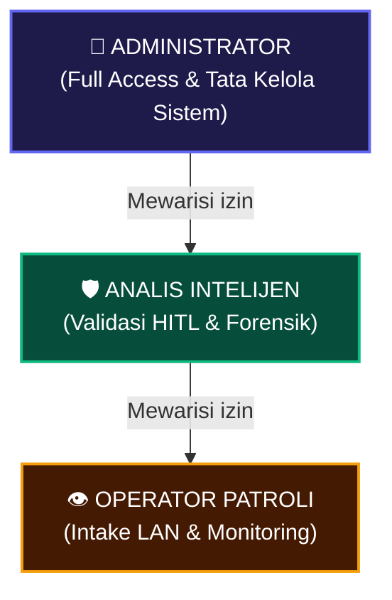

| Modul / Fungsi Sistem | OPERATOR | ANALYST | ADMIN | Dasar Kebijakan & Keamanan |
|---|:---:|:---:|:---:|---|
| **Intake via Ekstensi Browser LAN** | ✅ | ✅ | ✅ | Hak dasar personel patroli lapangan saat berselancar. |
| **Melihat Dashboard & Radar Tren** | ✅ | ✅ | ✅ | Situasi kesadaran operasional (*situational awareness*). |
| **Pencarian Arsip Temuan & Filter** | ✅ | ✅ | ✅ | Penelusuran data historis patroli lintas platform. |
| **Verifikasi Integritas Segel HMAC** | ✅ | ✅ | ✅ | Pengujian keabsahan bukti elektronik seketika. |
| **Validasi Bukti (HITL Dossier)** | ❌ | ✅ | ✅ | Wewenang analis untuk menetapkan vonis resmi pada dossier temuan. |
| **Koreksi Kategori & Rekam Memori** | ❌ | ✅ | ✅ | Otomatis dipromosikan ke `validated_memory` saat analis menyimpan vonis. |
| **Ekspor Laporan PDF & Markdown** | ❌ | ✅ | ✅ | Kerahasiaan dokumen Berita Acara dan laporan analitis dinas. |
| **Simulasi Tamper Bukti (Dry-Run)** | ❌ | ❌ | ✅ | Pengujian forensik supervisor/sidang pembuktian integritas bukti. |
| **Manajemen Pengguna & Konfigurasi** | ❌ | ❌ | ✅ | Mencegah eskalasi hak akses (*least privilege*). |

---

## 1.4 Ruang Lingkup Sistem & Batasan Batas (*Scope & Boundary*)

### Dalam Ruang Lingkup (In-Scope — Terimplementasi 100%):
1. **Universal 3-Layer Browser Extension (MV3)**: Google Chrome / Microsoft Edge / Brave dengan ekstraksi anti-noise, isolasi kontainer `<article>`, penanganan highlight operator, dan stempel waktu ISO-8601 UTC.
2. **Cakupan 5 Sumber Target Utama**:
   - **X / Twitter**: Isolasi kontainer artikel di titik tengah viewport, pembuangan menu/tren sampingan.
   - **Instagram & Threads**: Ekstraksi caption, username kreator, dan pemisahan poster gambar.
   - **Facebook**: Ekstraksi post timeline dan metadata pengunggah.
   - **YouTube**: Ekstraksi judul, deskripsi kanal, dan metadata durasi/penayangan.
   - **Portal Berita Nasional**: Ekstraksi OpenGraph/JSON-LD dan artikel berita (Kompas, Detik, Tempo).
3. **Penyegelan Kriptografis NIST FIPS 198-1**: HMAC-SHA256 kanonikal bebas ambiguitas delimiter dengan verifikasi *constant-time* dan simulasi tamper 3 mode (`IMAGE_BIT_FLIP`, `TEXT_MUTATION`, `METADATA_SPOOF`).
4. **Selective Local OCR Engine**: Pemrosesan OCR lokal cerdas yang otomatis melewati teks DOM panjang ($\ge 30$ chars) dan hanya memproses gambar berteks minim.
5. **MemPrompt Adaptive Learning**: Proyeksi vektor dense 384-dimensi, dynamic few-shot prompt injection dari kasus tervalidasi analis, dan deduplikasi semantik kembar harian ($\ge 0.85$).
6. **Local LLM Triage (Ollama)**: Inferensi lokal `qwen2.5:7b` dengan pembatas semafor GPU dan ekstraksi skema JSON baku 5W+1H dan 8 kategori IPOLEKSOSBUDHANKAM.
7. **Unified Operational Cockpit (React 18 + Vite)**: Dasbor analitik terpadu 3 menu inti (**Ringkasan**, **Radar Isu**, **Arsip Temuan**), *collapsible sidebar* berpersistensi lokal, paritas tema 100% (*Cyber-Dark Obsidian* & *Clean Light Mode*), dan estetika *Anti-Slop* berkarakter intelijen (*Linear/Palantir Gotham*).
8. **Dual Reporting & Multi-Dimensional PDF Generator**: Ekspor Berita Acara harian (Markdown & ReportLab Numbered PDF) serta modal filter Laporan PDF Analitis (Harian, Mingguan, Kustom) langsung dari konsol operasional.

---

## 1.5 Kebutuhan Fungsional (*Functional Requirements: FR-01 s.d. FR-26*)

| ID | Nama Kebutuhan | Deskripsi Fungsional Lengkap | Status |
|---|---|---|:---:|
| **FR-01** | **Universal 3-Layer Capture** | Ekstensi mengekstrak teks via Prioritas 0 (Highlight), Layer 1 (OpenGraph/JSON-LD), atau Layer 2 (Viewport Semantic Article). | ✅ Selesai |
| **FR-02** | **Spatial Anti-Sidebar Isolation** | Ekstensi secara tegas mengecualikan `<aside>`, widget rekomendasi, dan bilah sisi navigasi dari penangkapan konten. | ✅ Selesai |
| **FR-03** | **Clean Screenshot Rendering** | Ekstensi menyembunyikan badge mengambang dan modal triase saat perekaman tangkapan layar berlangsung. | ✅ Selesai |
| **FR-04** | **Dynamic LAN Host Routing** | Ekstensi mendukung penggantian host server dinas (`http://IP:8000`) dan operator_id secara instan dengan auto-ping. | ✅ Selesai |
| **FR-05** | **Strict ISO-8601 UTC Binding** | Ekstensi menyematkan format penanggalan UTC seragam `YYYY-MM-DDTHH:MM:SSZ` sebelum transmisi payload. | ✅ Selesai |
| **FR-06** | **NIST FIPS 198-1 Sealing** | Backend menyegel bukti menggunakan HMAC-SHA256 dari JSON kanonik alfabetis terurut (`sort_keys=True`). | ✅ Selesai |
| **FR-07** | **Constant-Time Verification** | Endpoint verifikasi menggunakan `hmac.compare_digest` untuk mengeliminasi celah timing attack. | ✅ Selesai |
| **FR-08** | **Safe Dry-Run Tamper Test** | Endpoint `/tamper-test` memfasilitasi simulasi manipulasi bit gambar, teks, dan metadata tanpa merusak database. | ✅ Selesai |
| **FR-09** | **Selective Local OCR** | OCR otomatis dilewati jika teks DOM $\ge 30$ karakter, dan otomatis dipicu jika teks minim/kosong atau terindikasi noise. | ✅ Selesai |
| **FR-10** | **Local Ollama Inference** | Analisis konten menggunakan Ollama lokal (`qwen2.5:7b`) menghasilkan skema JSON baku 5W+1H & IPOLEKSOSBUDHANKAM. | ✅ Selesai |
| **FR-11** | **GPU Semaphore Guard** | Penggunaan `asyncio.Semaphore(1)` untuk mengantrekan inferensi bersamaan dari banyak operator LAN. | ✅ Selesai |
| **FR-12** | **Deterministic Heuristic Failopen**| Jika Ollama offline, sistem otomatis beralih ke rule-based NLP lokal tanpa kehilangan bukti HMAC. | ✅ Selesai |
| **FR-13** | **MemPrompt Few-Shot Retrieval**| Menyuntikkan top-3 kasus preseden analis manusia ke prompt LLM berdasarkan kemiripan kosinus vektor dense 384-d. | ✅ Selesai |
| **FR-14** | **Semantic Deduplication** | Mendeteksi postingan kembar pada hari kalender sama dengan ambang batas kosinus $\ge 0.85$. | ✅ Selesai |
| **FR-15** | **SQLite WAL Concurrency** | Basis data beroperasi dalam mode WAL dengan busy timeout 60s untuk keamanan konkurensi LAN. | ✅ Selesai |
| **FR-16** | **Autonomous Trending Engine** | Penghitungan tren topik berjalan mandiri tiap 5 menit di latar belakang tanpa tombol manual. | ✅ Selesai |
| **FR-17** | **Daily Intelligence Export** | Ekspor rekapitulasi harian dalam format Markdown (.md) dan Dossier PDF resmi berpenomoran (ReportLab). | ✅ Selesai |
| **FR-18** | **Quantitative Evaluation Suite** | Skrip evaluasi komparatif 24 kasus mengukur Akurasi, Precision, Recall, Macro-F1, dan Latensi. | ✅ Selesai |
| **FR-19** | **Automated In-Dossier HITL Loop** | Validasi vonis analis di `ContentDetail.tsx` otomatis memicu `MemoryService.add_validated_case` ke `validated_memory` di balik layar tanpa halaman kurasi manual. | ✅ Selesai |
| **FR-20** | **Direct Link Web Triage** | Fasilitas triase URL langsung dari konsol dasbor bagi analis tanpa ekstensi terpasang. | ✅ Selesai |
| **FR-21** | **Analytical PDF Dossier Generator**| Modal filter PDF analitis (Harian, Mingguan, Kustom + Filter Kategori) dari tombol ikon kompak di halaman Ringkasan. | ✅ Selesai |
| **FR-22** | **Unified Single-Stream Overview** | Penggabungan metrik operasi, grafik aktivitas, proporsi risiko, kanal platform, serta topik & aktor sasaran dalam 1 halaman terpadu. | ✅ Selesai |
| **FR-23** | **Collapsible Tactical Sidebar** | Sidebar responsif dapat dilipat (`w-[68px]`) atau diperluas (`w-60`) dengan persistensi `localStorage`. | ✅ Selesai |
| **FR-24** | **Editorial Dossier & Anti-Slop UI**| Tata letak 5W+1H hierarkis asimetris, *kicker* taktis Indonesia, paritas Dark/Light 100%, dan status fresh-install database. | ✅ Selesai |
| **FR-25** | **Tactical BLUF Dossier Standard** | Ringkasan analitis mengadopsi 5 pilar BLUF (*Bottom Line Up Front*): Intisari, Fakta vs Klaim, Proyeksi Dampak, Aktor & Modus, serta Rekomendasi Tindakan. | ✅ Selesai |
| **FR-26** | **Anti-Aliased Logo Omnipresence** | Integrasi logo resmi transparan (*anti-aliased alpha matting*) pada Web Dashboard (Favicon, Sidebar, Navbar, Login), Ekstensi MV3 (Icons 16-128, Popup, Floating Badge), dan KOP Laporan PDF ReportLab. | ✅ Selesai |

---

## 1.6 Kebutuhan Non-Fungsional (*Non-Functional Requirements*)

* **NFR-01 (Kerahasiaan Data / Data Privacy):** 0% payload data dikirim ke luar jaringan LAN lokal dinas.
* **NFR-02 (Integritas Bukti / Tamper Evidence):** Perubahan 1 bit pada berkas bukti visual atau karakter teks menghasilkan status `TAMPERED` seketika.
* **NFR-03 (Latensi Kriptografi):** Verifikasi segel HMAC-SHA256 selesai dalam waktu $< 0.1$ milidetik.
* **NFR-04 (Efisiensi Komputasi):** Selective OCR menghemat $> 80\%$ penggunaan memori dan siklus GPU pada artikel berita teks panjang.
* **NFR-05 (Ketahanan Konkurensi LAN):** Basis data tidak mengalami error *database locked* saat diakses simultan oleh hingga 10 operator LAN berkat mode SQLite WAL dan `busy_timeout=60000`.
* **NFR-06 (Kebersihan Diagnostik & Build):** 0 error kompilasi TypeScript (`tsc`), 0 peringatan build Vite, dan 0 error kompilasi bytecode Python (`compileall`).
* **NFR-07 (Ketahanan Ekstraksi Konten):** Sistem mampu membedakan konten narasi dan metadata serta kebal terhadap pengacakan nama kelas CSS media sosial.
* **NFR-08 (Zero Dead-End Interconnectivity):** Seluruh metrik, topik teratas, tokoh sasaran, dan baris temuan pada antarmuka web terhubung langsung ke tampilan detail atau filter aktif tanpa jalan buntu.
* **NFR-09 (Clean Fresh-Install Baseline):** Basis data terdistribusi dalam kondisi 0 baris transaksional kotor (*fresh-install ready*) dengan tabel pengguna bawaan (`admin`) siap pakai.

---

# BAB II: DATA FLOW DIAGRAM (DFD) & WORKFLOW PIPELINES LENGKAP

## 2.1 DFD Level 0 (Context Diagram)

Diagram konteks menunjukkan interaksi tingkat tinggi antara entitas luar (Operator Patroli dan Analis Intelijen) dengan Sistem TILIK.

```mermaid
flowchart LR
    Operator["👁️ OPERATOR PATROLI<br/>(Stasiun Kerja LAN)"]
    Analis["🛡️ ANALIS INTELIJEN<br/>(Meja Analisis Kasus)"]
    Sistem["⚙️ SISTEM TILIK v5.2<br/>(FastAPI + Ollama + SQLite WAL + Web Cockpit)"]

    Operator -->|1. Postingan Media Sosial + Tangkapan Layar| Sistem
    Sistem -->|2. Nomor Tiket Resmi + Status Segel HMAC| Operator

    Sistem -->|3. Dashboard Tren, Radar Isu, & Dossier 5W+1H| Analis
    Analis -->|4. Vonis Validasi HITL (VALIDATED / MODIFIED / REJECTED)| Sistem
    Analis -->|5. Permintaan Laporan PDF Analitis / Berita Acara| Sistem
    Sistem -->|6. Berkas Laporan Resmi PDF & Markdown (.md)| Analis
```

---

## 2.2 DFD Level 1 (Dekomposisi Proses Utama Sistem)

Dekomposisi proses utama memetakan 7 modul inti sistem TILIK:

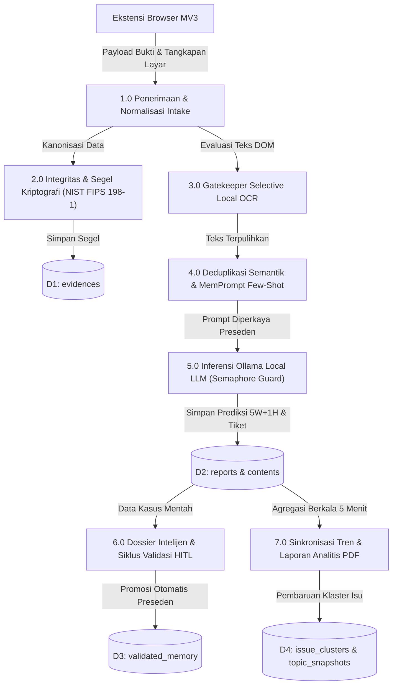

---

## 2.3 Rincian DFD Level 2 (Sub-Proses Kritis Kerja Sistem)

### 2.3.1 DFD Level 2.1: Akuisisi Presisi Universal 3-Layer & Pemisahan Noise Bilah Sisi
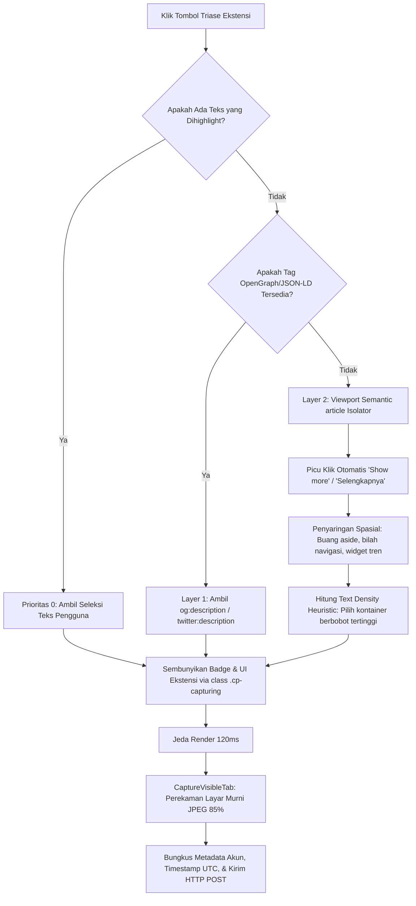

### 2.3.2 DFD Level 2.2: Penyegelan Kriptografi NIST FIPS 198-1 HMAC-SHA256
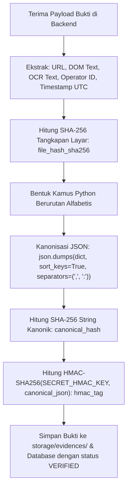

### 2.3.3 DFD Level 2.3: Multimodal Quality Gate & Selective Local OCR
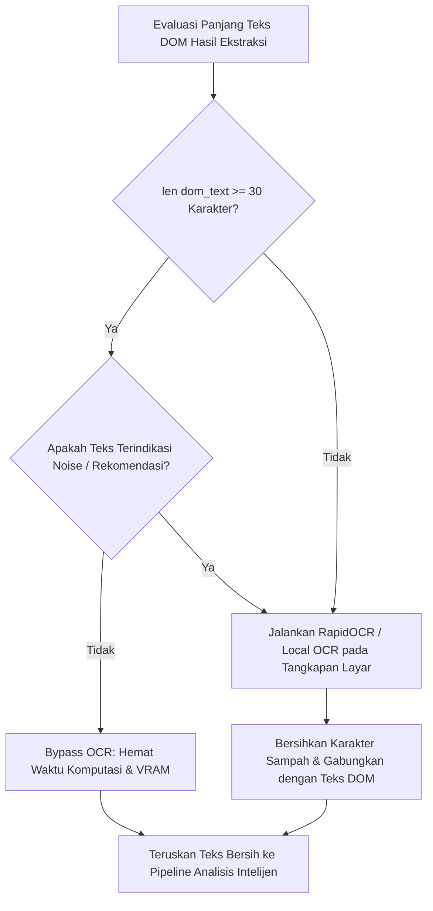

### 2.3.4 DFD Level 2.4: MemPrompt In-Context Learning & Deduplikasi Semantik
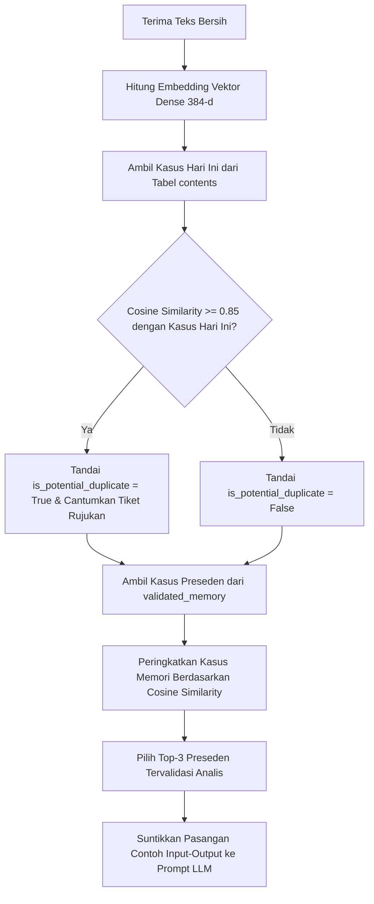

### 2.3.5 DFD Level 2.5: Inferensi Ollama Local LLM & GPU Semaphore Guard
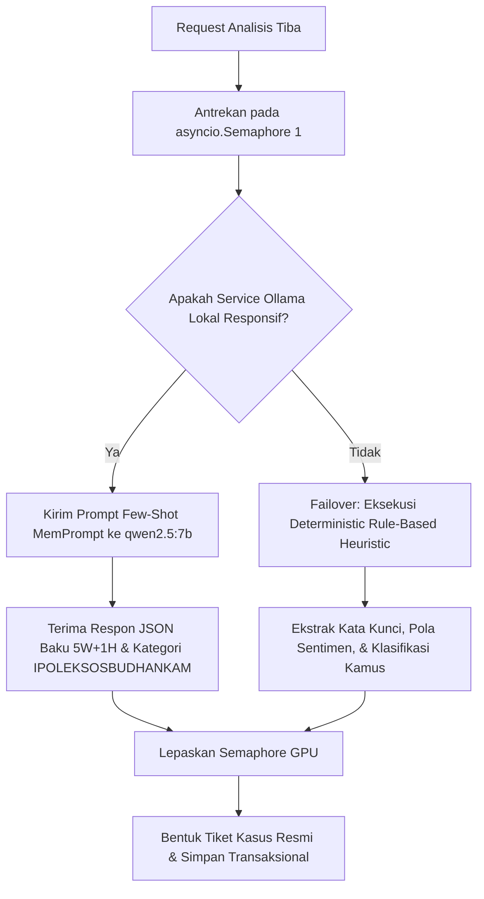

### 2.3.6 DFD Level 2.6: Autonomous Background Trending Synchronizer
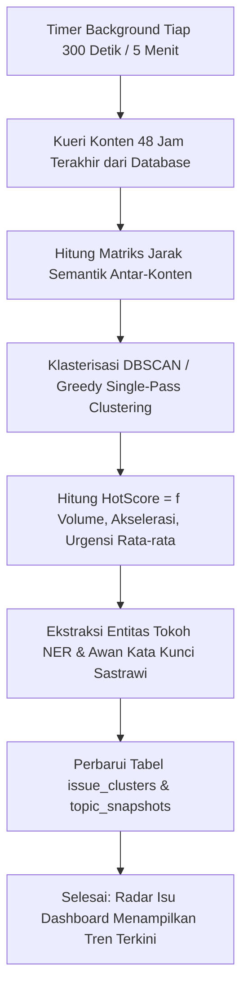

### 2.3.7 DFD Level 2.7: Siklus Validasi & Pembelajaran Otomatis Human-in-the-Loop (HITL)
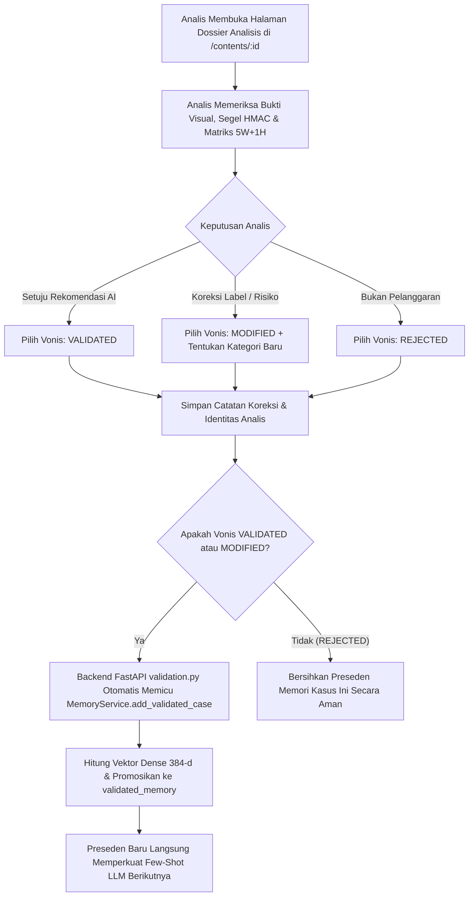

### 2.3.8 DFD Level 2.8: Pembangkit Dokumen Berita Acara & Laporan Analitis Multivariat
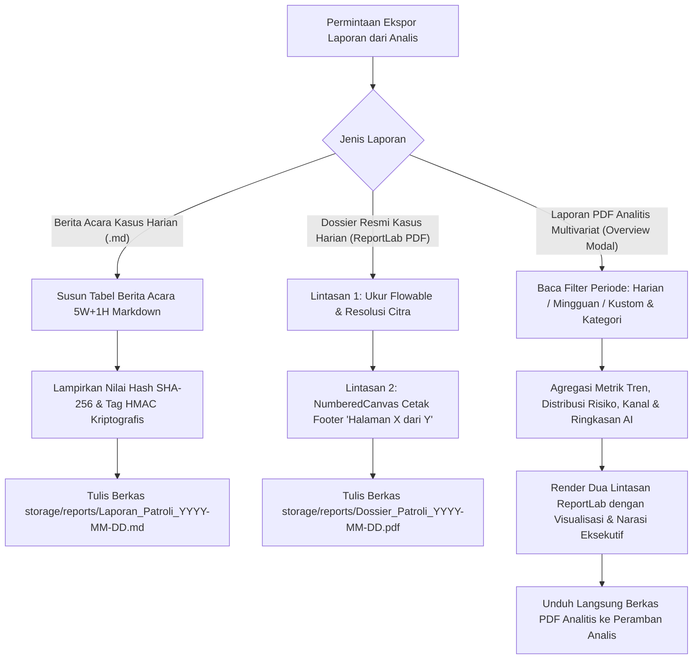

---

## 2.4 End-to-End Sequence Diagram

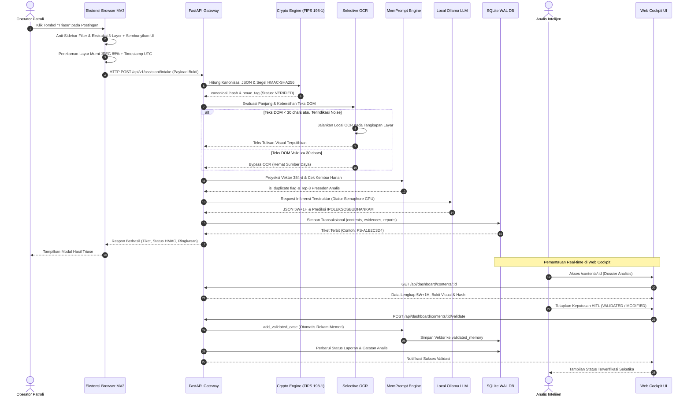

---

# BAB III: ARSITEKTUR SISTEM & PERANCANGAN TEKNIS DETAIL

## 3.1 Blok Arsitektur C4 / Komponen Fisik & Logis

```
┌────────────────────────────────────────────────────────────────────────────────────────┐
│                                CLIENT TIER (PERAMBAN WORKSTATION DINAS)                │
│                                                                                        │
│   ┌──────────────────────────────────────────────────┐  ┌──────────────────────────┐  │
│   │     Universal 3-Layer Browser Extension (MV3)    │  │   Web Intelligence UI    │  │
│   │                                                  │  │     (React 18 + Vite)    │  │
│   │  • Priority 0: Highlight-to-Capture              │  │                          │  │
│   │  • Layer 1: OpenGraph & JSON-LD Extractor        │  │  • Ringkasan (Unified)   │  │
│   │  • Layer 2: Viewport Semantic <article> Isolator │  │  • Radar Isu & Tren      │  │
│   │  • Spatial Anti-Sidebar Exclusion Filter         │  │  • Arsip Temuan          │  │
│   │  • Text Density Algorithm & Show More Expander   │  │  • Editorial Dossier     │  │
│   │  • JPEG 85% Clean Screen Capturer                │  │  • Automated HITL Action │  │
│   │  • Dynamic LAN Host Router & Health Check        │  │  • Collapsible Sidebar   │  │
│   │  • Strict ISO-8601 UTC Timestamp Binding         │  │  • Analytical PDF Modal  │  │
│   └─────────────────────────┬────────────────────────┘  │  • 100% Theme Parity     │  │
│                             │                           └────────────┬─────────────┘  │
└─────────────────────────────┼────────────────────────────────────────┼────────────────┘
                              │ HTTP POST (Multipart & JSON)           │
                              ▼                                        ▼
┌────────────────────────────────────────────────────────────────────────────────────────┐
│                          GATEWAY & SERVICE TIER (FASTAPI REST ENGINE)                  │
│                                                                                        │
│   ┌─────────────────────────┐  ┌─────────────────────────┐  ┌──────────────────────┐  │
│   │   app/api/v1/assistant  │  │   app/api/v1/integrity  │  │ app/api/dashboard    │  │
│   │   (Intake & Smart Gate) │  │   (HMAC & Tamper Test)  │  │ (Auth, Radar, HITL)  │  │
│   └────────────┬────────────┘  └────────────┬────────────┘  └──────────┬───────────┘  │
│                │                            │                          │              │
│                ▼                            ▼                          ▼              │
│   ┌────────────────────────────────────────────────────────────────────────────────┐  │
│   │                            CORE BUSINESS SERVICES                              │  │
│   │  • CryptoService: NIST FIPS 198-1 HMAC-SHA256 & Constant-Time Verification     │  │
│   │  • OCRService: Selective RapidOCR Engine (< 30 chars threshold bypass)         │  │
│   │  • MemoryService: Dense 384-d MemPrompt Few-Shot & Semantic Twin Deduplication │  │
│   │  • OllamaService: Local Qwen2.5 / Llama3.1 with asyncio.Semaphore(1) Guard     │  │
│   │  • PDFReportService: ReportLab Two-Pass Numbered Analytical Dossier Generator  │  │
│   └────────────────────────────────────────┬───────────────────────────────────────┘  │
└────────────────────────────────────────────┼───────────────────────────────────────────┘
                                             │ SQL Statements & File I/O
                                             ▼
┌────────────────────────────────────────────────────────────────────────────────────────┐
│                        DATA TIER (PERSISTENSI LOKAL ON-PREMISE)                        │
│                                                                                        │
│   ┌──────────────────────────────────────────┐  ┌──────────────────────────────┐   │
│   │   SQLite Database (storage/patrol.db)    │  │  Local Encrypted File System │   │
│   │                                          │  │                              │   │
│   │   • contents (Bukti Digital Kanonikal)   │  │ • storage/evidences/         │   │
│   │   • reports (Vonis 5W+1H & Tiket)        │  │   (Tangkapan Layar Bersih)   │   │
│   │   • validated_memory (MemPrompt Preseden)│  │ • storage/reports/           │   │
│   │   • issue_clusters & topic_snapshots     │  │   (Dossier PDF & Berkas MD)  │   │
│   │   • audit_logs & dashboard_users         │  │ • Fresh-Install Clean State  │   │
│   │   • PRAGMA journal_mode=WAL; (LAN Safe)  │  │                              │   │
│   └──────────────────────────────────────────┘  └──────────────────────────────┘   │
└────────────────────────────────────────────────────────────────────────────────────────┘
```

---

## 3.2 Klien: Ekstensi Peramban Universal 3-Layer Manifest V3

Ekstensi peramban mengatasi kelemahan selektor CSS statis yang sering diacak oleh platform media sosial melalui 4 prinsip teknis:

### 3.2.1 Strategi Anti-Perubahan UI & Isolasi Spasial Anti-Sidebar
* **Masalah:** Pada platform media sosial (seperti X.com), modul rekomendasi akun di sebelah kanan (berlabel *"Relevant people"* atau *"What's happening"*) secara internal juga dibungkus tag semantik yang memiliki atribut `role="article"`. Akibatnya, pergerakan mouse operator ke pojok kanan bawah dapat secara tidak sengaja mengunci modul rekomendasi tersebut.
* **Solusi Spasial:**
  * Pembatasan cakupan pencarian kontainer hanya di dalam elemen `<main role="main">` atau `[data-testid="primaryColumn"]`.
  * Pengecualian mutlak (*blacklist*) terhadap kontainer sampingan: `aside`, `[role="complementary"]`, `[data-testid="sidebarColumn"]`, dan elemen berlabel rekomendasi akun.

### 3.2.2 Algoritma Kepadatan Teks (*Text Density*) & Auto-Expander Long Post
* **Auto-Expander:** Sebelum mengekstrak teks, skrip mendeteksi keberadaan tombol ekspansi postingan panjang (*Show more*, *Selengkapnya*, `[data-testid="tweet-text-show-more-link"]`) dan memicu klik otomatis agar seluruh paragraf terbuka sempurna.
* **Text Density Heuristic:** Menghitung rasio jumlah kata terhadap tag HTML pada setiap blok anak di dalam artikel. Kontainer dengan rasio teks tertinggi dan minim tombol interaktif otomatis dinobatkan sebagai teks narasi utama.
* **OpenGraph Backup:** Membaca tag standar `<meta name="twitter:description">` dan `<meta property="og:description">` dari `<head>` dokumen yang wajib dipelihara oleh platform demi kebutuhan pratinjau tautan (*link preview*).

### 3.2.3 Pemisahan Tegas Metadata vs Teks Narasi Konten
Sistem memetakan entitas data secara independen:
1. **Identitas Akun (`author_username` & `display_name`):** Diekstrak dari pola URL kanonikal (`/status/...`, `/p/...`, `/@user/...`) yang dikonfirmasi oleh blok profil pengunggah, bukan dari sembarang tautan di halaman.
2. **Waktu Terbit (`posted_at`):** Diambil dari atribut baku `datetime` pada tag `<time>`.
3. **Metrik Interaksi:** Diambil dari nilai numerik tombol aksi atau atribut aksesibilitas `aria-label`.
4. **Teks Narasi (`dom_text`):** Teks murni bebas dari penanda antarmuka, komentar pengikut, dan banner likes.

### 3.2.4 Perekaman Layar Bersih (*Clean Visual Evidence Rendering*)
* Saat perintah penangkapan layar dieksekusi, badge mengambang (`#cyber-patrol-floating-badge`) dan seluruh jendela modal disembunyikan instan menggunakan kelas CSS `.cp-capturing` (`display: none !important; visibility: hidden !important;`).
* Diberikan jeda rendering $120\text{ ms}$ agar mesin peramban selesai menggambar ulang frame murni tanpa elemen UI ekstensi, menjamin bukti visual otentik dan bersih untuk kebutuhan persidangan.

---

## 3.3 Backend: Layered Micro-Modular FastAPI Architecture

Arsitektur backend memisahkan tanggung jawab modul secara tegas:
* `app/api/v1/assistant.py`: Endpoint intake dan triase live (`/api/v1/assistant/intake`), dilengkapi *Smart Noise Gate* dan normalisasi identitas akun berbasis URL.
* `app/api/v1/integrity.py`: Endpoint verifikasi integritas segel HMAC (`/api/v1/integrity/verify-canonical`) dan pengujian simulasi tamper dry-run (`/api/v1/integrity/tamper-test`).
* `app/api/v1/report_export.py`: Endpoint ekspor rekapitulasi harian (`/api/v1/reports/daily/export`).
* `app/api/dashboard/`: Autentikasi JWT, radar topik tren mandiri, endpoint analitik terpadu (`/api/dashboard/overview`), serta validasi HITL analis dengan pembelajaran otomatis (`/api/dashboard/contents/:id/validate`).
* `app/services/`: Logika bisnis mandiri tanpa ketergantungan melingkar (*loose coupling*).

---

## 3.4 Arsitektur Basis Data: SQLite WAL High-Concurrency & Skema Relasional

Basis data dirancang untuk menangani konkurensi multi-user LAN:
* **Mode WAL (Write-Ahead Logging):** Membaca data tidak memblokir penulisan data (`Readers do not block writers, and writers do not block readers`).
* **Busy Timeout 60 Detik:** Menghilangkan galat *database locked* saat banyak request intake masuk bersamaan dari berbagai workstation operator.
* **Auto-Migration Engine:** `app/database.py` memeriksa dan menambahkan kolom-kolom baru secara otomatis tanpa merusak data yang telah ada.
* **Fresh-Install Clean Baseline:** Seluruh tabel transaksional direset bersih (0 baris kotor) dengan akun `admin` bawaan tetap aktif, menjamin kesiapan instalasi baru dinas.

### Skema Entitas Relasional (ERD Inti):

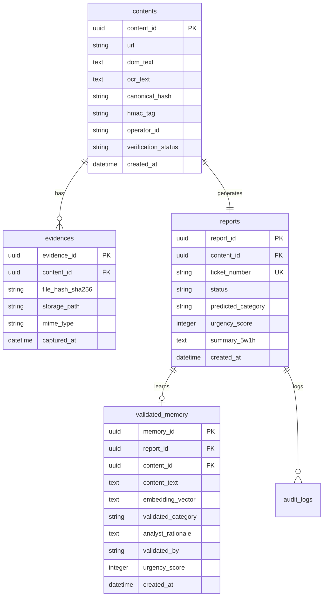

---

## 3.5 Cryptographic Integrity Engine (NIST FIPS 198-1 HMAC-SHA256)

1. **Format Serialisasi Kanonik Bebas Ambiguitas:**
   * Menghindari konkatenasi string polos berkarakter pemisah yang rentan serangan pemalsuan delimiter.
   * Format serialisasi baku:
     ```python
     canonical_dict = {
         "captured_at_utc": captured_at_utc,
         "dom_text": dom_text or "",
         "ocr_text": ocr_text or "",
         "operator_id": operator_id,
         "screenshot_sha256": screenshot_sha256,
         "source_url": source_url,
     }
     canonical_json = json.dumps(
         canonical_dict,
         sort_keys=True,
         separators=(",", ":"),
         ensure_ascii=False
     )
     ```
2. **Kalkulasi Nilai Hash & Tag HMAC:**
   * $\text{CanonicalHash} = \text{SHA256}(\text{CanonicalJSON})$
   * $\text{HMACTag} = \text{HMAC-SHA256}(K, \text{CanonicalJSON})$
   * Kunci rahasia $K$ (`SECRET_HMAC_KEY`) dikonfigurasi melalui `.env` server lokal tertutup.
3. **Verifikasi Constant-Time:**
   * Verifikasi menggunakan `hmac.compare_digest(stored_hmac, recomputed_hmac)` yang berjalan dalam waktu tetap tanpa terpengaruh posisi bita yang berbeda, mengeliminasi serangan analisis waktu (*timing attacks*).

---

## 3.6 Mesin Dokumen: ReportLab Two-Pass Numbered PDF Dossier

* **Dua Lintasan Render (`NumberedCanvas`):** Menghitung total halaman dokumen secara dinamis dan mencetak format footer resmi `"Halaman X dari Y"`.
* **In-Memory Downsampling Citra:** Mengompresi citra visual ke resolusi proporsional JPEG 85 sehingga berkas PDF 20+ kasus tetap ringan ($< 1.5\text{ MB}$) dan terbentuk dalam $< 4$ detik.
* **Format Berita Acara Resmi:** Judul berpenomoran urut dinas, badge kategori IPOLEKSOSBUDHANKAM, tautan kanonikal aktif, tabel matriks 5W+1H, kotak pertimbangan analis, foto snapshot tajam, dan stempel segel kriptografis HMAC-SHA256.

---

## 3.7 Arsitektur Web Cockpit Intelijen (React 18, TypeScript, Vite & Tailwind CSS)

### 3.7.1 Alur Navigasi 3 Menu Inti & Collapsible Sidebar
Arsitektur navigasi TILIK disederhanakan secara terfokus menjadi **3 menu inti**:
1. **Ringkasan (`/`):** Pusat komando operasional terpadu yang menampilkan indikator KPI, grafik aktivitas, proporsi risiko, sebaran platform/kategori, serta ringkasan topik dan aktor sasaran.
2. **Radar Isu (`/trending`):** Radar deteksi tren narasi viral nasional, kalkulasi HotScore dinamis, awan kata kunci, dan pemantauan entitas prioritas.
3. **Arsip Temuan (`/contents`):** Buku besar forensik digital (*Forensic Ledger*) yang memuat seluruh tangkapan bukti, tiket investigasi, status validasi, dan penelusuran multivariat.

Komponen **`Sidebar.tsx`** mengimplementasikan mekanisme *Collapsible Navigation*:
* **Mode Terbuka (*Extended*, `w-60`):** Menampilkan logo TILIK, label grup operasional, ikon menu, dan teks navigasi lengkap.
* **Mode Terlipat (*Collapsed*, `w-[68px]`):** Menyembunyikan label teks dan menyajikan ikon terpusat dengan *tooltip* saat kursor diarahkan (*hover*).
* **Persistensi State:** Status lipat/buka disimpan secara deterministik di `localStorage` peramban (`tilik_sidebar_collapsed`) dan bertransisi mulus dengan durasi 200 ms.

### 3.7.2 Konsol Operasional Tunggal Terpadu (`Overview.tsx`) & Mesin Visualisasi SVG
Mengeliminasi tab pemisah guna menghadirkan alur pemantauan vertikal yang kohesif:
1. **Baris 1 (Header & Filter):** *Kicker* taktis `KONSOL OPERASIONAL // TILIK`, judul resmi, tombol unduh PDF analitis minimalis berbentuk ikon persegi (`p-2.5 rounded-lg`), dan bilah parameter operasi (tanggal, platform, kategori, risiko).
2. **Baris 2 (KPI Strip Asimetris):** 4 kartu ringkas (*Total Temuan*, *Isu Aktif*, *Urgensi Tinggi*, *Status Validasi*) dengan dukungan warna aksen (`accentColor`), indikator tren, dan mikro-interaksi klik taktil `active:scale-[0.98]`.
3. **Baris 3 (Grafik Tren & Risiko):** Grid asimetris 8:4 memadukan grafik garis ganda SVG (`DualLineChart`: Laporan Masuk vs Tervalidasi) dan diagram donat interaktif (`DonutChart`: Distribusi Tingkat Risiko).
4. **Baris 4 (Distribusi Kanal & Kategori):** Diagram batang vertikal kanal platform (`VerticalBarChart`) dan daftar progres horizontal kategori isu (`HorizontalBarList`).
5. **Baris 5 (Radar & Sasaran 2 Kolom):** Daftar *Topik Isu Teratas* dan *Tokoh & Entitas Sasaran* berdampingan, masing-masing dilengkapi tautan cepat menuju radar isu.
6. **Baris 6 (Tabel Temuan Prioritas Linear):** Daftar 8 laporan prioritas terbaru dengan badge risiko dan status berbahasa Indonesia yang dapat diklik langsung menuju dossier temuan.

### 3.7.3 Radar Isu Terkoneksi (`TrendingTopics.tsx`) & Sinkronisasi Query Parameter
* Menerima parameter pencarian URL (`?q=...` dan `?actor=...`) yang diteruskan saat analis mengeklik topik atau tokoh di halaman Ringkasan.
* Komponen membaca parameter melalui `useSearchParams()` saat dimuat dan langsung mengaktifkan filter terkait tanpa perlu input manual.
* Didukung pilar filter instan (*Isu Aktual*, *Isu Kritikal*, *Isu Tematik*, *Semua Isu*) tanpa mengunci atau mengenolkan penghitung metrik.

### 3.7.4 Editorial Intelligence Dossier (`ContentDetail.tsx`) & Hierarki 5W+1H
Halaman pemeriksaan bukti disusun dengan tata letak editorial intelijen komersial:
* **Grid Asimetris 7:5:** Kolom kiri (7 kolom) mengisolasi bukti visual murni tangkapan layar, nilai hash SHA-256 dan tag HMAC monospaced dengan tombol salin seketika (*copy-to-clipboard*), aksi verifikasi integritas, tombol uji simulasi tamper bit-flip, serta teks narasi terjemahan berbahasa Indonesia.
* **Hierarki Matriks 5W+1H:** Menghilangkan kotak-kotak seragam monoton dan menggantinya dengan struktur redaksional terarah:
  - *Baris Utama:* **WHAT // Peristiwa Inti** selebar kartu dengan aksen garis kiri biru tebal.
  - *Baris Konteks:* **WHO // Pihak Terlibat** (aksen emerald) berdampingan dengan **WHY // Motif & Indikasi** (aksen amber).
  - *Baris Spatio-Temporal:* **WHEN // Waktu**, **WHERE // Lokasi**, dan **HOW // Modus Operandi** dalam grid 3 kolom taktis.
* **Otomasi Pembelajaran HITL:** Tombol vonis analis (*Setuju*, *Ubah*, *Tolak*) langsung mengeksekusi validasi dan secara otonom mempromosikan entri ke `validated_memory` di backend.

### 3.7.5 Standar Estetika Anti-Slop, Kicker Taktis Indonesia & Paritas Tema Ganda
* **Anti-Slop Craft:** Menghindari template generik AI (gradasi ungu-biru seragam atau kartu monoton datar) dan menerapkan palet otoritatif intelijen (*Linear/Palantir Gotham*).
* **Paritas 100% Dark & Light Mode:**
  - *Dark Mode:* Latar belakang Obsidian Canvas (`#090A0F`), kartu Obsidian Surface (`#0F1117`), garis batas halus (`border-white/[0.08]`), dan teks kontras tinggi.
  - *Light Mode:* Latar belakang bersih (`bg-slate-50`), permukaan kartu putih murni (`bg-white border-slate-200/80 shadow-xs`), teks gelap tegas (`text-slate-900` & `text-slate-600`).
* **Workstation Login Paritas Penuh:** Halaman autentikasi (`Login.tsx`) dilengkapi sakelar `ThemeToggle` di sudut kanan atas dan mendukung penuh tema terang maupun gelap.
* **Kicker Monospace Bahasa Indonesia:** Disematkan di seluruh tajuk halaman (`KONSOL OPERASIONAL // TILIK`, `RADAR INTELIJEN // TILIK`, `ARSIP FORENSIK // TILIK`, `DOSSIER ANALISIS // TILIK`, `DOSSIER KLUSTER ISU // TILIK`).

### 3.7.6 Generator Laporan PDF Analitis Multidimensi
* Modal filter laporan PDF analitis terintegrasi di pojok kanan atas halaman Ringkasan.
* Mendukung 3 mode periode: **Harian (Daily)**, **Mingguan (Weekly)**, dan **Rentang Tanggal Kustom (Custom Date Range)**.
* Dilengkapi dropdown filter kategori IPOLEKSOSBUDHANKAM.
* Menghasilkan berkas PDF analitis resmi beresolusi tinggi, lengkap dengan visualisasi grafik, rekapitulasi numerik, dan narasi intelijen tanpa galat pembagian nol saat database bersih.

---

# BAB IV: MESIN KECERDASAN BUATAN (AI), VISION, & PEMBELAJARAN ADAPTIF

## 4.1 Transisi 100% On-Premise: Ollama Local LLM

Menggantikan ketergantungan API cloud eksternal dengan inferensi **Ollama lokal** (`http://127.0.0.1:11434`):
* **Model Rekomendasi:** `qwen2.5:7b` (keseimbangan optimal antara pemahaman konteks bahasa Indonesia dan efisiensi memori) atau `llama3.1:8b`.
* **Keluaran Terstruktur JSON Baku:**
  ```json
  {
    "summary_5w1h": {
      "who": "Pihak yang terlibat / akun pengunggah",
      "what": "Inti narasi atau pokok persoalan",
      "when": "Waktu peristiwa / publikasi",
      "where": "Lokasi kejadian atau platform publikasi",
      "why": "Latar belakang / motif pembahasan",
      "how": "Kronologi atau bagaimana narasi disebarkan"
    },
    "predicted_category": "Ideologi|Politik|Ekonomi|Sosial|Budaya|Pertahanan|Keamanan|Non-Isu",
    "urgency_score": 1,
    "ai_reasoning": "Penalaran analitis berbasis konteks teks"
  }
  ```

---

## 4.2 Selective Local OCR Engine & Smart Noise Gate

1. **Ambang Batas Bypass Komputasi ($\ge 30$ Karakter):**
   * Memeriksa panjang string `dom_text`. Jika $\ge 30$ karakter dan bukan karakter sampah, modul OCR dilewati total.
   * Mengurangi latensi pipa analisis dari $\sim 3.2\text{ detik}$ menjadi $< 0.4\text{ detik}$ pada $80\%$ kasus teks panjang.
2. **Selective Triggering:**
   * Modul RapidOCR hanya aktif jika teks DOM kosong, teks $< 30$ karakter, atau terindikasi gambar poster/meme.
3. **Smart Noise Gate:**
   * Menganalisis rasio karakter alfanumerik terhadap total bita payload guna mencegah pemrosesan sampah teks navigasi platform.

---

## 4.3 MemPrompt In-Context Learning & Deduplikasi Semantik

1. **Vektorisasi Padat (Dense Embedding):**
   * Menggunakan model transformer lokal untuk memetakan teks narasi ke dalam vektor dense 384-dimensi bernormalisasi $L_2$.
2. **Dynamic In-Context Injection:**
   * Saat menerima konten baru, sistem melakukan pencarian *Cosine Similarity* terhadap kasus-kasus yang tersimpan di `validated_memory`.
   * Top-3 kasus paling mirip yang telah divalidasi oleh analis manusia disuntikkan secara dinamis ke dalam prompt Ollama sebagai panduan *Few-Shot*.
3. **Deduplikasi Semantik Kembar Harian:**
   * Jika nilai *Cosine Similarity* terhadap postingan lain pada hari yang sama mencapai $\ge 0.85$, sistem menandai kasus sebagai duplikat potensial dan menautkan nomor tiket asalnya untuk mencegah redundansi investigasi.

---

## 4.4 Struktur Ekstraksi Intelijen 5W+1H & Standar IPOLEKSOSBUDHANKAM

Sistem mengekstrak dimensi intelijen secara komprehensif:
* **Who (Siapa):** Pelaku utama, akun penyebar, atau tokoh publik yang menjadi sasaran narasi.
* **What (Apa):** Inti peristiwa atau substansi klaim yang dipersoalkan.
* **When (Kapan):** Waktu terjadinya insiden atau stempel waktu publikasi.
* **Where (Di Mana):** Lokasi geografis kejadian atau yurisdiksi ruang digital.
* **Why (Mengapa):** Motif yang mendasari, provokasi terselubung, atau sentimen keresahan masyarakat.
* **How (Bagaimana):** Modus operandi penyebaran narasi, fabrikasi bukti, atau taktik manipulasi informasi.

Setiap temuan diklasifikasikan ke dalam salah satu dari 8 pilar ketahanan nasional:
1. **Ideologi:** Paham radikalisme, separatisme, anti-Pancasila.
2. **Politik:** Kampanye hitam, disinformasi pemilu, polarisasi kebijakan publik.
3. **Ekonomi:** Penipuan finansial massal, rumor perbankan, kepanikan pangan.
4. **Sosial:** Isu keresahan publik, konflik horizontal masyarakat.
5. **Budaya:** Pelanggaran norma kesusilaan, degradasi nilai kearifan lokal.
6. **Pertahanan:** Sabotase instalasi pertahanan, spionase, kebocoran alutsista.
7. **Keamanan:** Perjudian daring, terorisme, kejahatan siber terorganisir.
8. **Non-Isu:** Konten netral, hiburan wajar, atau klarifikasi resmi institusi.

---

## 4.5 Penanganan Konkurensi GPU & Zero-Lag Heuristic Failover

1. **GPU Semaphore Guard:**
   * Inferensi model AI lokal dilindungi oleh semafor asinkron `asyncio.Semaphore(1)` untuk mencegah *Out-of-Memory (OOM)* pada kartu grafis stasiun kerja lokal saat banyak operator mengirim data bersamaan.
2. **Zero-Lag Heuristic Failover:**
   * Apabila daemon Ollama mengalami kendala atau tidak aktif, sistem secara instan mengalihkan pipeline ke modul NLP heuristik berbasis aturan lokal (*rule-based fallback*).
   * Menjamin bahwa seluruh proses intake dan penyegelan bukti kriptografis tetap berjalan lancar tanpa mengalami *timeout* atau kegagalan transmisi.

---

# BAB V: TOLOK UKUR EVALUASI, MATRIKS FITUR, & STRUKTUR REPOSITORI

## 5.1 Hasil Pengujian Kuantitatif (Benchmark 24 Kasus IPOLEKSOSBUDHANKAM)

Evaluasi kuantitatif mandiri dijalankan menggunakan skrip `scripts/evaluate_tilik.py` pada 24 kasus uji *ground-truth* representatif 8 bidang IPOLEKSOSBUDHANKAM menggunakan model inferensi lokal Ollama `qwen2.5:3b` dan model *embedding* `bge-m3`:

### Profil Performa Sistem Aktual:
| Parameter / Metrik Pengujian | Nilai Performa Aktual | Keterangan Operasional |
|---|:---:|---|
| **Akurasi Klasifikasi** | **95.83%** (23/24 kasus) | 23 dari 24 kasus uji teridentifikasi tepat sesuai *ground-truth* |
| **Macro Precision** | **96.88%** | Rata-rata presisi prediksi antarseluruh 8 bidang isu |
| **Macro Recall** | **95.83%** | Rata-rata sensitivitas penangkapan isu antarseluruh 8 bidang |
| **Macro F1-Score** | **95.71%** | Keseimbangan harmonik presisi dan recall |
| **Rerata Latensi Retrieval (BGE-M3)** | **2,505.12 ms** | Pencarian preseden semantik vektor *dense* 384-dimensi L2 |
| **Rerata Latensi Pipeline (CPU 8-Thread)** | **158.84 s** | Inferensi lokal penuh tanpa ketergantungan koneksi internet eksternal |
| **F1-Score Bidang Ideologi** | **100.0%** | Sempurna (Precision: 100.0%, Recall: 100.0%, 3/3 kasus) |
| **F1-Score Bidang Politik** | **100.0%** | Sempurna (Precision: 100.0%, Recall: 100.0%, 3/3 kasus) |
| **F1-Score Bidang Ekonomi** | **85.7%** | Sangat Kuat (Precision: 75.0%, Recall: 100.0%, 3/3 kasus) |
| **F1-Score Bidang Sosial** | **100.0%** | Sempurna (Precision: 100.0%, Recall: 100.0%, 3/3 kasus) |
| **F1-Score Bidang Budaya** | **100.0%** | Sempurna (Precision: 100.0%, Recall: 100.0%, 3/3 kasus) |
| **F1-Score Bidang Pertahanan** | **100.0%** | Sempurna (Precision: 100.0%, Recall: 100.0%, 3/3 kasus) |
| **F1-Score Bidang Keamanan** | **80.0%** | Kuat (Precision: 100.0%, Recall: 66.7%, 2/3 kasus) |
| **F1-Score Bidang Non-Isu** | **100.0%** | Sempurna (Precision: 100.0%, Recall: 100.0%, 3/3 kasus) |

*Berkas hasil pengujian tersimpan otomatis dalam:*
* `storage/evaluation_results.json` (Detail metrik dan profil per kasus).
* `storage/evaluation_results.csv` (Tabel terstruktur untuk lampiran Bab IV Tugas Akhir).

---

## 5.2 Matriks Fitur Terimplementasi

```
┌──────────────────────────────────────┬──────────────────────┬──────────────────┬──────────────────┐
│ Modul / Fitur                        │ Status Implementasi  │ Uji Verifikasi   │ Lokasi Kode      │
├──────────────────────────────────────┼──────────────────────┼──────────────────┼──────────────────┤
│ Universal 3-Layer Extension (MV3)    │ 100% Siap Operasi    │ Terverifikasi    │ extension/       │
│ Spatial Anti-Sidebar Filter          │ 100% Siap Operasi    │ Terverifikasi    │ content.js       │
│ Clean Screenshot Rendering           │ 100% Siap Operasi    │ Terverifikasi    │ content.js       │
│ Dynamic LAN Host Router              │ 100% Siap Operasi    │ Terverifikasi    │ popup.js         │
│ NIST FIPS 198-1 HMAC-SHA256 Engine   │ 100% Siap Operasi    │ Terverifikasi    │ crypto_service.py│
│ Constant-Time Integrity Verification │ 100% Siap Operasi    │ Terverifikasi    │ integrity.py     │
│ Safe Dry-Run Tamper Simulation       │ 100% Siap Operasi    │ Terverifikasi    │ integrity.py     │
│ SQLite WAL Multi-User Concurrency    │ 100% Siap Operasi    │ Terverifikasi    │ database.py      │
│ Selective Local OCR & Smart Gate     │ 100% Siap Operasi    │ Terverifikasi    │ ocr_service.py   │
│ Local Ollama AI (qwen2.5:7b)         │ 100% Siap Operasi    │ Terverifikasi    │ ollama_service.py│
│ GPU Semaphore Asynchronous Guard     │ 100% Siap Operasi    │ Terverifikasi    │ ollama_service.py│
│ Zero-Lag Heuristic Fallback Engine   │ 100% Siap Operasi    │ Terverifikasi    │ ollama_service.py│
│ MemPrompt Dynamic Few-Shot Engine    │ 100% Siap Operasi    │ Terverifikasi    │ memory_service.py│
│ Semantic Twin Deduplication (>= 0.85)│ 100% Siap Operasi    │ Terverifikasi    │ memory_service.py│
│ Automated In-Dossier HITL Learning   │ 100% Siap Operasi    │ Terverifikasi    │ validation.py    │
│ Autonomous Background Trending Engine│ 100% Siap Operasi    │ Terverifikasi    │ main.py          │
│ Unified Single-Stream Overview Page  │ 100% Siap Operasi    │ Terverifikasi    │ Overview.tsx     │
│ Collapsible Tactical Sidebar (w-60)  │ 100% Siap Operasi    │ Terverifikasi    │ Sidebar.tsx      │
│ Editorial Dossier (Hierarki 5W+1H)   │ 100% Siap Operasi    │ Terverifikasi    │ ContentDetail.tsx│
│ Radar Isu Terkoneksi (URL Params)    │ 100% Siap Operasi    │ Terverifikasi    │ TrendingTopics...│
│ Analytical PDF Export Modal          │ 100% Siap Operasi    │ Terverifikasi    │ Overview.tsx     │
│ 100% Dark/Light Theme Parity         │ 100% Siap Operasi    │ Terverifikasi    │ ThemeContext.tsx │
│ ReportLab Two-Pass Numbered PDF      │ 100% Siap Operasi    │ Terverifikasi    │ pdf_report_ser...│
│ Daily Markdown (.md) Report Export   │ 100% Siap Operasi    │ Terverifikasi    │ report_export.py │
│ Fresh-Install Clean Baseline State   │ 100% Siap Operasi    │ Terverifikasi    │ storage/patrol.db│
│ Single-Command Runner (run.bat/py)   │ 100% Siap Operasi    │ Terverifikasi    │ run.py, run.bat  │
│ Quantitative Evaluation Benchmark    │ 100% Siap Operasi    │ Terverifikasi    │ evaluate_tilik.py│
│ Tactical BLUF Dossier (5 Pilar)      │ 100% Siap Operasi    │ Terverifikasi    │ ContentDetail.tsx│
│ Anti-Aliased Logo Omnipresence       │ 100% Siap Operasi    │ Terverifikasi    │ Dashboard, Ext, PDF│
└──────────────────────────────────────┴──────────────────────┴──────────────────┴──────────────────┘
```

---

## 5.3 Inventaris Kode Sumber & Struktur Direktori

```text
cyber-patrol-assistant/
│
├── run.bat                          # Launcher instan Windows (Batch)
├── run.ps1                          # Launcher instan Windows (PowerShell)
├── run.py                           # Runner tunggal: FastAPI + Dashboard mounting + Port killer
├── cspell.json                      # Kamus spell-checker (6,600+ istilah resmi domain)
├── .env                             # Konfigurasi environment variabel lokal
├── .env.example                     # Template konfigurasi variabel lingkungan
├── SYSTEM_PRD_AND_ARCHITECTURE.md   # Dokumen spesifikasi kebutuhan produk & arsitektur (Dokumen ini)
├── README.md                        # Panduan operasional dan ringkasan sistem
│
├── app/                             # Paket Utama Backend (FastAPI)
│   ├── main.py                      # ASGI entrypoint, CORS, PNA, Lifespan, Auto-Trending Worker
│   ├── config.py                    # Konfigurasi Pydantic BaseSettings
│   ├── database.py                  # Engine SQLAlchemy, SQLite WAL Mode, Skema Auto-Migration
│   ├── static/                      # Aset statis backend
│   │   └── logo-tilik.png           # Master logo transparan resmi backend (256x256)
│   │
│   ├── api/                         # Lapisan Rute REST API
│   │   ├── v1/
│   │   │   ├── assistant.py         # Endpoint intake (/api/v1/assistant/intake & smart gate)
│   │   │   ├── integrity.py         # Endpoint verifikasi segel & simulasi tamper
│   │   │   ├── report_export.py     # Endpoint ekspor rekap harian (.md & .pdf)
│   │   │   └── admin.py             # Endpoint administratif
│   │   └── dashboard/               # Endpoint web dashboard cockpit
│   │       ├── auth.py              # Login JWT & profil pengguna
│   │       ├── contents.py          # Penjelajah konten dan visual bukti
│   │       ├── validation.py        # Validasi HITL analis & rekam memori otomatis
│   │       └── trending.py          # Radar isu viral, klaster topik & aktor sasaran
│   │
│   ├── models/                      # Skema Database Relasional (SQLAlchemy ORM)
│   │   ├── report.py                # Model Account, Content, Report
│   │   ├── evidence.py              # Model Evidence (file_hash_sha256, storage_path)
│   │   ├── memory.py                # Model ValidatedMemory (Preseden pembelajaran adaptif)
│   │   └── audit.py                 # Model AuditLog (Chain of Custody)
│   │
│   └── services/                    # Lapisan Logika Bisnis & Mesin Intelijen
│       ├── crypto_service.py        # NIST FIPS 198-1 HMAC-SHA256 & Constant-Time Engine
│       ├── ollama_service.py        # Local Ollama Inference & Structured Output 5W+1H
│       ├── memory_service.py        # MemPrompt Few-Shot & Semantic Twin Deduplication
│       ├── ocr_service.py           # Selective Local OCR Engine (< 30 chars threshold)
│       └── pdf_report_service.py    # Mesin penyusun Dossier PDF berpenomoran ReportLab
│
├── dashboard/                       # Aplikasi Frontend Web (React 18 + TypeScript + Vite)
│   ├── index.html                   # Template HTML
│   ├── vite.config.ts               # Konfigurasi build Vite & chunk splitting
│   ├── package.json                 # Konfigurasi dependensi frontend
│   ├── tailwind.config.js           # Konfigurasi palet tema Obsidian & typography
│   ├── public/                      # Aset publik statis frontend
│   │   ├── favicon.png              # Favicon resmi web (64x64 transparan)
│   │   └── logo-tilik.png           # Logo aplikasi resmi web (512x512 transparan)
│   ├── src/
│   │   ├── App.tsx                  # Rute navigasi utama (3 menu inti + 2 detail + login)
│   │   ├── index.css                # Style global, animasi shimmer & scrollbar
│   │   ├── types.ts                 # Definisi tipe TypeScript domain patroli
│   │   ├── api/client.ts            # Klien HTTP Axios terpadu
│   │   ├── context/
│   │   │   ├── AuthContext.tsx      # Manajemen sesi JWT pengguna
│   │   │   └── ThemeContext.tsx     # Manajemen tema ganda Dark (Obsidian) & Light Mode
│   │   ├── pages/
│   │   │   ├── Overview.tsx         # Konsol Operasional Tunggal Terpadu & Modal PDF
│   │   │   ├── TrendingTopics.tsx   # Radar Isu & Tren Strategis (Terkoneksi URL Params)
│   │   │   ├── IssueDetail.tsx      # Dossier Kluster Isu & Dinamika Narasi
│   │   │   ├── ContentExplorer.tsx  # Arsip Temuan Patroli & Forensic Ledger
│   │   │   ├── ContentDetail.tsx    # Editorial Dossier Analisis (5 Pilar BLUF) & Validasi HITL
│   │   │   └── Login.tsx            # Workstation Login dengan ThemeToggle Terintegrasi
│   │   └── components/
│   │       ├── layout/
│   │       │   ├── Navbar.tsx       # Header minimalis & profil operator
│   │       │   ├── Sidebar.tsx      # Collapsible Tactical Sidebar (w-60 / w-[68px])
│   │       │   └── DashboardLayout.tsx # Layout shell responsif
│   │       └── common/
│   │           ├── ThemeToggle.tsx  # Sakelar taktil tema gelap / terang
│   │           ├── Charts.tsx       # Mesin grafik responsif SVG (DualLine, Donut, Bars)
│   │           ├── KPICard.tsx      # Kartu metrik dengan accent color & tactile click
│   │           └── Badge.tsx        # Badge semantik platform, risiko, sentimen & status
│   └── dist/                        # Bundle produksi frontend siap saji
│
├── extension/                       # Ekstensi Peramban (Manifest V3)
│   ├── manifest.json                # Konfigurasi Chrome MV3 resmi
│   ├── icons/                       # Aset ikon ekstensi transparan resmi
│   │   ├── icon16.png               # Ikon toolbar peramban (16x16)
│   │   ├── icon32.png               # Ikon retina & floating badge (32x32)
│   │   ├── icon48.png               # Ikon manajemen ekstensi & header popup (48x48)
│   │   └── icon128.png              # Ikon instalasi toko peramban (128x128)
│   ├── popup.html / popup.js        # Antarmuka popup akuisisi bukti & router LAN dinamis
│   ├── content.js / content.css     # Universal 3-Layer Script, Anti-Sidebar Filter, Clean Capture
│   └── background.js                # Service Worker: captureVisibleTab & fetch proxy
│
├── scripts/                         # Skrip Otomasi & Evaluasi
│   ├── evaluate_tilik.py            # Tolok ukur evaluasi kuantitatif komparatif (24 kasus)
│   └── ingest_real_patrol_data.py   # Seeding data patroli awal
│
├── tests/                           # Test Suite Otomatis
│   ├── test_live_comprehensive_e2e.py # Uji integrasi penuh end-to-end tanpa mock (100% Pass)
│   ├── test_tilik_full_pipeline.py  # Uji otomatis seluruh pipeline TILIK (5/5 suites PASS)
│   ├── test_api_dashboard.py        # Uji otomatis endpoint dashboard & analitik
│   └── test_rag_entities.py         # Uji modul retrieval MemPrompt & entitas
│
└── storage/                         # Repositori Penyimpanan Berkas Lokal
    ├── patrol.db                    # Database SQLite WAL (Kondisi Fresh-Install Bersih)
    ├── evidences/                   # Direktori berkas tangkapan layar monitor
    ├── reports/                     # Direktori arsip berkas laporan PDF & Markdown
    ├── evaluation_results.json      # Keluaran detail benchmark evaluasi
    └── evaluation_results.csv       # Keluaran tabel metrik evaluasi Bab IV
```

---

## 5.4 Konfigurasi Lingkungan (`.env`) & Single-Command Runner

### Contoh Konfigurasi `.env`:
```ini
# --- [Identitas & Kriptografi Inti] ---
ENV=development
SECRET_KEY=supersecretkey_patrol_2026_field_aligned
DASHBOARD_SECRET_KEY=dashboard_jwt_secret_patrol_2026
SECRET_HMAC_KEY=kunci-rahasia-hmac-sha256-tilik-fips198-rplk-2026
JWT_ALGORITHM=HS256
JWT_EXPIRE_MINUTES=480

# --- [Koneksi Basis Data (SQLite WAL Mode)] ---
DATABASE_URL=sqlite:///./storage/patrol.db

# --- [Mesin AI Lokal (Ollama)] ---
OLLAMA_BASE_URL=http://127.0.0.1:11434
OLLAMA_MODEL=qwen2.5:7b

# --- [Direktori Penyimpanan] ---
EVIDENCE_DIR=storage/evidences
REPORTS_DIR=storage/reports

# --- [Parameter Radar Tren Isu] ---
TRENDING_REFRESH_SECONDS=300
```

### Prosedur Menjalankan Sistem:
Cukup jalankan satu perintah berikut di terminal:
```powershell
.\run.bat
```
Server backend FastAPI dan Web Dashboard akan aktif seketika pada:
* **Web Cockpit Dashboard:** `http://127.0.0.1:8000/dashboard/`
* **Dokumentasi Interaktif API (Swagger UI):** `http://127.0.0.1:8000/docs`

---

**Disusun dan Disahkan oleh:**  
*TILIK — Sistem Pemantauan & Analisis Konten Siber*  
*Platform Pemantauan Siber Berintegritas Kriptografis*
